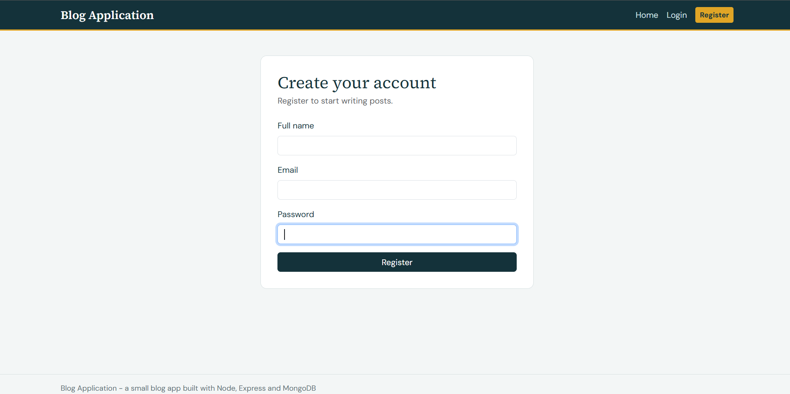
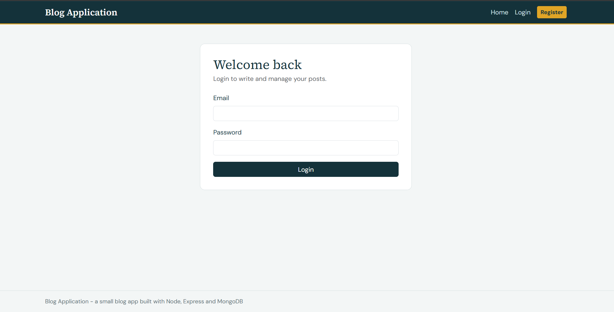
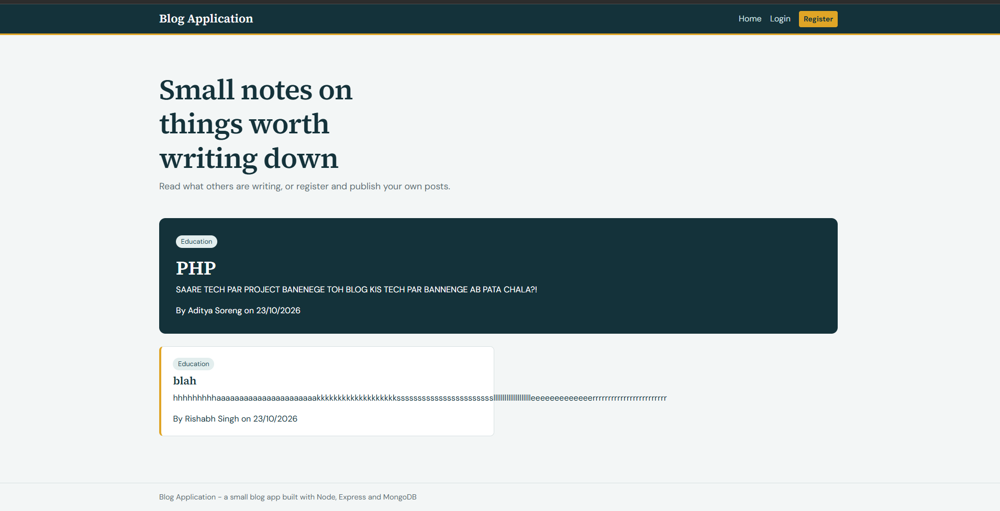
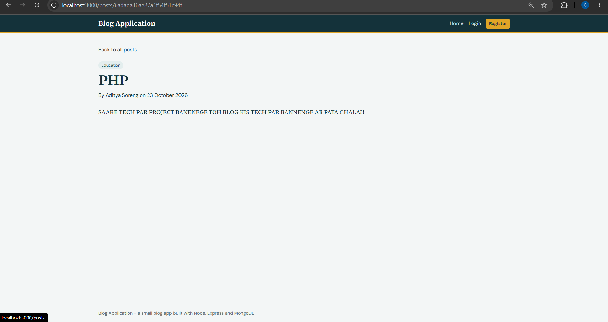
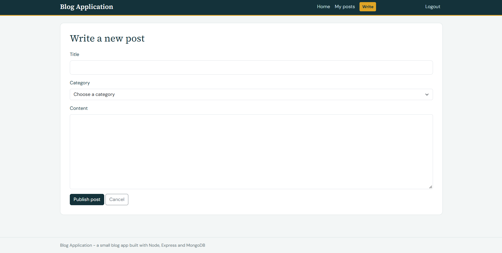
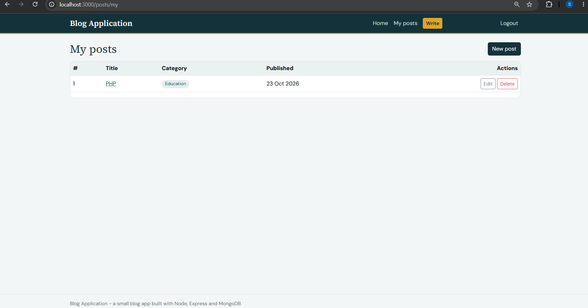
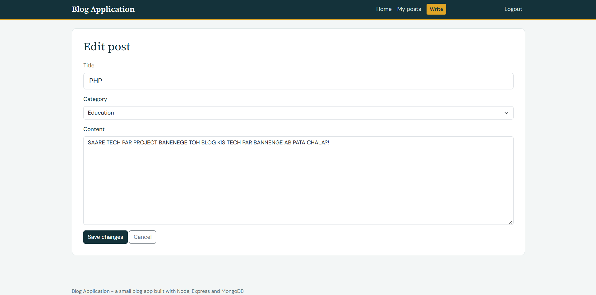
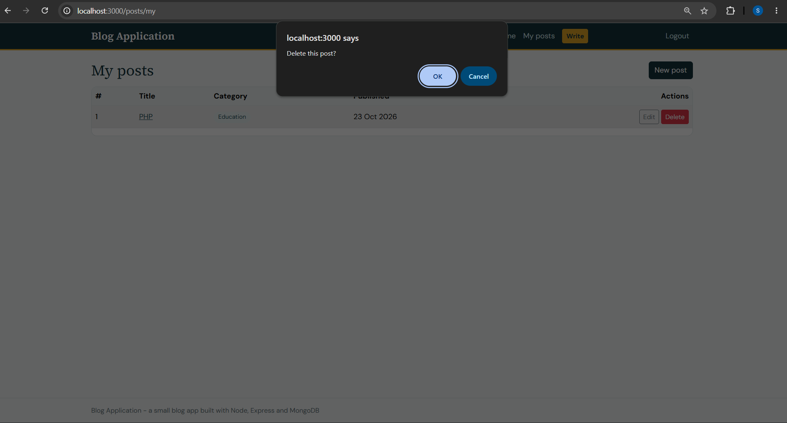

# Blog Application

## Objective
To develop a session-based Blog Application where users can register, log in and manage their own blog posts (create, read, update and delete) using the MVC architecture.

## Technologies Used
- Node.js
- Express.js
- MongoDB
- Mongoose
- EJS
- Bootstrap 5
- express-session
- bcrypt
- dotenv


## Folder Structure
```
models/
controllers/
routes/
middleware/
views/
public/
screenshots/
app.js
db.js
.env
```

## Screenshots








